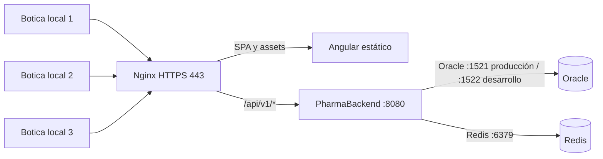

# PharmaSoft

SPA en Angular 22 para administrar categorías, productos y clientes mediante PharmaBackend.

## Requisitos

- Node.js 22.22.3 o 24.15 LTS.
- Angular CLI 22.
- Oracle y PharmaBackend ejecutándose en `http://localhost:8080`.

## Ejecutar el frontend

```powershell
npm install
npm start
```

Abre `http://localhost:4200`. La URL base de la API está en `src/environments/environment.ts` y `environment.development.ts`.

## Estructura

- `src/app/core`: configuración del menú, modelo de errores y utilidades HTTP compartidas.
- `src/app/shared`: páginas reutilizables, incluida la ruta 404.
- `src/app/layout`: layout principal, encabezado y sidebar.
- `src/app/features`: módulos de negocio de Inicio, Categorías, Productos y Clientes.

Los módulos concentran sus rutas, modelos, servicios HTTP y páginas de listado y formulario. Productos usa `GET http://localhost:8080/api/v1/productos` con `pagina`, `tamanio`, `ordenarPor` y `direccion`; ofrece paginación y orden del servidor, filtro local por categoría en la página cargada, categorías activas en el formulario y baja lógica. Las operaciones de detalle, alta, cambio y baja usan la misma ruta versionada.

El backend `sysventas` conserva las rutas `/api/productos` y `/api/categorias` para clientes existentes, y expone además `/api/v1/productos` y `/api/v1/categorias` para la SPA.

## Compilar

```powershell
npm run build
```

## Despliegue en producción

El navegador de los tres locales accede a una sola instalación HTTPS. Nginx entrega el build de Angular, revalida `index.html`, sirve los recursos con hash como inmutables y reenvía `/api/` a PharmaBackend. El backend lee Oracle y Redis en la red privada.



### Variables del entorno

El frontend de producción usa rutas relativas (`/api/v1`) y no guarda secretos en Angular. Define estas variables en el servicio de backend, mediante el gestor de secretos del servidor:

| Variable | Propósito |
|---|---|
| `SPRING_PROFILES_ACTIVE` | Selecciona `prod` para cargar la configuración de producción. |
| `SERVER_PORT` | Puerto interno HTTP del backend; por defecto, `8080`. |
| `DB_URL` | URL JDBC de Oracle para el servicio del entorno. |
| `DB_USERNAME` / `DB_PASSWORD` | Credenciales del esquema de PharmaSoft. |
| `REDIS_HOST` / `REDIS_PORT` | Dirección del Redis privado; el puerto por defecto es `6379`. |
| `JWT_SECRET` | Clave HMAC en Base64, de al menos 256 bits. Mantenerla fuera del repositorio. |
| `JWT_EXPIRACION_MINUTOS` | Vigencia de los JWT; por defecto, `60`. |
| `FRONTEND_ORIGINS` | Orígenes HTTPS exactos separados por coma para la política CORS. |

### Construcción y publicación

1. En integración continua, instalar las dependencias reproducibles con `npm ci` y generar el build con `npm run build`.
2. Publicar el contenido de `dist/pharma-frontend/browser` como una versión nueva del directorio estático de Nginx. Mantener la configuración de `deploy/nginx.conf`: `index.html` debe revalidarse y los `.js`/`.css` con hash pueden conservarse un año.
3. Configurar Nginx con TLS en `443`, redirigir `80` a `443` y ajustar `proxy_pass` de `/api/` a la dirección privada del backend en `8080`.
4. Publicar el backend con `SPRING_PROFILES_ACTIVE=prod` y las variables descritas en el README de sysventas. Verificar `/actuator/health` y una operación de lectura antes de habilitar el tráfico de los locales.

### Reversión

Cada publicación debe quedar en una carpeta o imagen versionada. Si la verificación falla, apunta Nginx a la versión estática anterior, restaura la versión previa del backend y reinicia el servicio. Conserva los archivos versionados de Angular junto con `index.html` para que ambos correspondan al mismo build. Las migraciones de base de datos deben tener una reversión compatible preparada antes de desplegar cambios de esquema.

### Estado de prácticas

| Práctica | Estado | Acción pendiente |
|---|---|---|
| Rutas y vistas no iniciales cargadas bajo demanda | Cumple | Conservar la medición del build en cada publicación. |
| `index.html` revalidable y assets con hash inmutables | Cumple | Confirmar los encabezados en el Nginx de producción. |
| API fuera de la caché privada del navegador | Cumple | Mantener las respuestas `no-store` de Spring Security. |
| Cachés Redis con TTL e invalidación de cambios | Cumple | Ejecutar la matriz de invalidación antes de cada release. |
| Identificador de petición en logs, cabeceras y errores | Cumple | Mantener el mismo ID al reportar incidencias. |
| Secretos fuera del código y de los logs de producción | Parcial | Configurar un gestor de secretos y auditar los logs del entorno. |
| TLS, respaldos y alertas operativas | Pendiente | Habilitar HTTPS, probar restauraciones de Oracle y alertar sobre health. |

### Recomendaciones para los tres locales

1. **Prioridad alta:** servir la SPA y el API solo por HTTPS y limitar el acceso a Oracle y Redis a la red privada.
2. **Prioridad alta:** automatizar copias de Oracle, conservarlas fuera del servidor y probar periódicamente una restauración.
3. **Prioridad media:** monitorear `/actuator/health` y latencia/errores de ventas, con alertas al responsable cuando el servicio o Redis falle.

El Compose de `deploy/` sirve para desarrollo local (`localhost:8081` y Redis); la publicación real debe añadir TLS y usar nombres privados para backend, Oracle y Redis.
